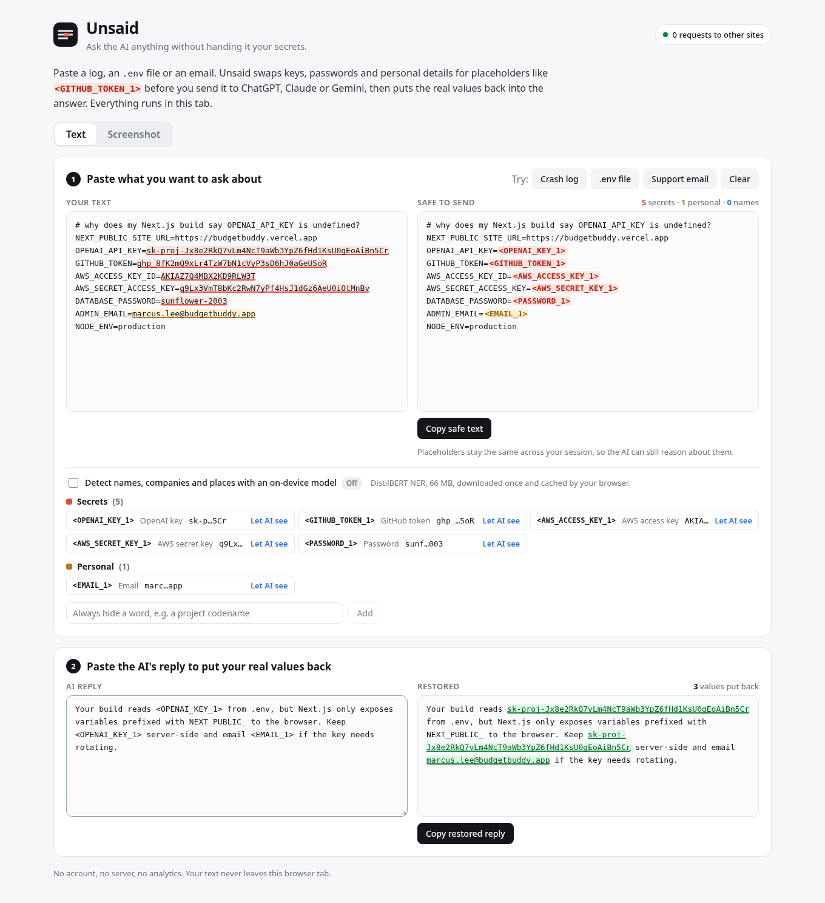

# Unsaid

Ask the AI anything without handing it your secrets.



**Demo video:** {{video_url}}

## What it does

- Finds API keys, passwords, tokens, emails, phone numbers, card numbers, IPs and OS usernames in anything you paste: logs, stack traces, `.env` files, emails, chat messages.
- Swaps each one for a stable placeholder like `<GITHUB_TOKEN_1>`, so ChatGPT, Claude or Gemini can still reason about the text ("`<PASSWORD_1>` is wrong for `<IP_ADDRESS_1>`").
- Paste the AI's reply back and Unsaid puts your real values back in, only on your screen.
- Redacts screenshots: reads the text with on-device OCR and covers each secret with a labeled box, ready to download.
- Optional on-device language model (DistilBERT NER) to hide names, companies and places.
- Runs entirely in the browser tab. No account, no server, no analytics. The header shows a live count of requests to other sites.

## Try it

Live demo: {{live_url}}

Fastest path: click **.env file** under step 1, then paste this into step 2:

```
Keep <OPENAI_KEY_1> server-side and email <EMAIL_1> if it needs rotating.
```

The restored panel shows the real key and email. For screenshots, open the **Screenshot** tab and click **Try a sample screenshot**.

Run it locally (Node 20+):

```bash
npm install
npm run fetch-model   # optional: serve the 66 MB NER model from your own origin instead of Hugging Face
npm run dev           # http://localhost:5173
```

## How it works

```
paste ──► 43 rules, 32 data types (prefixes, checksums, context) ───┐
      └─► DistilBERT NER in a Web Worker (optional) ───────────────────┼─► resolve overlaps ─► Vault ─► masked text
image ──► Tesseract OCR (grayscale, invert, 2x) ─► same detectors ─────┘                       │
AI reply ─────────────────────────────────────────────────────────────────────────────────────► restore
```

- **Detectors** (`src/core/rules.ts`): provider-specific key formats (AWS, GitHub, Stripe, OpenAI, Anthropic, Slack, Google, Hugging Face, npm, SendGrid, Twilio and more), context rules for `password=`, `--token`, `Authorization:`, cookies, connection strings and URL query secrets, plus Luhn (cards), mod-97 (IBAN), SSN ranges and IPv4/IPv6 validation. A Shannon-entropy fallback catches unknown tokens while skipping git SHAs, UUIDs, hashes and base64 images.
- **Vault** (`src/core/mask.ts`): each distinct value gets one placeholder per session, so the same key is always `<STRIPE_KEY_1>`. Restore tolerates the ways models rewrite placeholders (`[EMAIL_1]`, `EMAIL_1`, `&lt;EMAIL_1&gt;`). The vault lives in `sessionStorage` and disappears when you close the tab.
- **Names** (`src/workers/ner.worker.ts`): Transformers.js runs a quantized DistilBERT NER model on ONNX Runtime Web, off the main thread.
- **Screenshots** (`src/lib/ocr.ts`): Tesseract.js reads words with bounding boxes, words split by OCR are re-joined by pixel gap, and findings map back to boxes drawn on a canvas.

### Accuracy

Measured on two synthetic corpora written by separate authors who never saw the detector code (`bench/`). Real-looking fake secrets plus decoys: git SHAs, UUIDs, package-lock hashes, version numbers, placeholders, Luhn-failing card numbers.

| Set | Cases | Precision | Recall |
|---|---|---|---|
| Held-out set, first run before any tuning on it (rules only) | 60 | 0.949 | 0.926 |
| Both sets after fixing the error classes found (rules only) | 100 | 1.000 | 1.000 |
| Held-out set with names via NER | 60 | 0.905 | 0.950 |

The first row is the honest estimate for text it has never seen. Names are the weakest category (PERSON recall 13 of 20).

```bash
npm run bench                         # rule detectors on both corpora
npm run fetch-model && npm run bench  # also scores rules + NER
```

## Built with

TypeScript, React 19, Vite, Transformers.js (ONNX Runtime Web), Tesseract.js, Vitest, Playwright. NER model: [dslim/distilbert-NER](https://huggingface.co/dslim/distilbert-NER) via [onnx-community/distilbert-NER-ONNX](https://huggingface.co/onnx-community/distilbert-NER-ONNX).

## License

MIT. See [LICENSE](LICENSE).

## Development

```bash
npm test           # unit tests and benchmark
npx playwright test  # end-to-end tests against a production build (run npm run build first)
npm run build      # static site in dist/, deploy to any static host
```

See [docs/DEVELOPMENT.md](docs/DEVELOPMENT.md) for the project layout and deployment notes.
